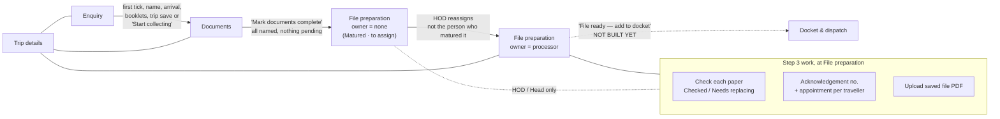
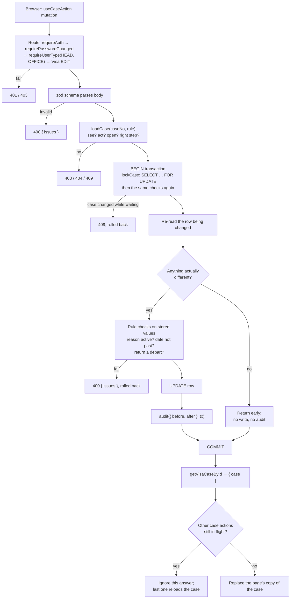
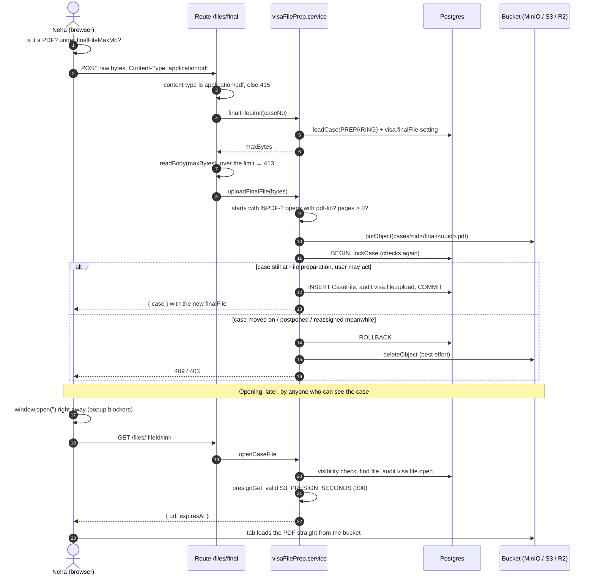

# Visa Step 3: file preparation — how the code works

This guide is for a developer opening this code for the first time. It explains what the feature does, which files
do what, and what happens, step by step, when someone uses it.

- **The business decisions** (why it works this way) are in
  [`docs/decisions/0007-visa-file-prep.md`](../decisions/0007-visa-file-prep.md).
- **This guide** describes the code as it is on the `feat/visa-file-prep` branch (12 Oct 2026), including the work
  not yet committed. Where the decision record plans something that isn't built yet, this guide says so.

---

## 1. What the feature is, in one paragraph

A visa case goes through steps: **Enquiry → Documents → File preparation → Docket & dispatch → …**. In Step 2
(Documents) the office collects every paper from the client. When everything is in, someone presses **Mark documents
complete**. The case then "matures": it moves to **File preparation** with no owner, and the Visa HOD hands it to a
**processor**. Step 3 is that processor's work:

1. **Check every paper again.** Each one is marked **Checked**, or **Needs replacing** with a reason from a list.
2. **Enter the trip details:** travelling out, coming back, the entry type and the hotel stay.
3. **Type in each traveller's portal details:** the acknowledgement number and the appointment from the government
   visa portal.
4. **Upload the saved file:** the whole visa file, scanned as **one PDF**, kept as proof in private S3-compatible
   storage.

Supporting all of this are three things the HOD manages: a **vendor master** (the agents files are sent to), a
**"document problems" list** (the reasons a paper needs replacing), and two switches on each visa,
**Appointment needed** and **Vendor needed**.

### What is built and what is not

| Part | Status |
| --- | --- |
| Matured banner | Built |
| Processor checks each paper | Built |
| "Document problems" reasons list | Built |
| Trip details | Built (uncommitted) |
| Acknowledgement number and appointment per traveller | Built (uncommitted) |
| Appointment needed / Vendor needed switches on the visa | Built (uncommitted): stored, editable in Settings → Masters → Checklists, and the case page follows them. Nothing enforces them yet. |
| Saved file (PDF upload and opening) | Built |
| Vendor master (Settings → Masters → Lists → Vendors) | Built |
| **Picking a vendor on a case** (`PUT …/vendor`, `VisaCase.vendorId`) | **Not built.** No column, no route. |
| **"File ready — add to docket"** (`POST …/file-ready`, `fileReadyAt`) | **Not built.** No column, no route. Nothing moves a case out of File preparation yet. |
| Covering letter, "Log in for me", passport-scan reading, print form | Not in scope here (decision record, Decision 2) |

Keep the last rows in mind as you read: today, a case at File preparation stays there.

---

## 2. Where the code lives

### Backend (`Backend/`)

| File | What it does |
| --- | --- |
| `src/modules/visa/visa.routes.ts` | The HTTP endpoints. Parses input with zod, calls a service, returns `{ case }`. No rules live here. |
| `src/modules/visa/visa.schemas.ts` | zod schemas for every request body (Step 3 section at the bottom). |
| `src/modules/visa/caseLock.ts` | **The heart of the safety rules.** Who may change a case, at which step, and the row lock that makes changes take turns. |
| `src/modules/visa/visaFilePrep.service.ts` | Step 3 writes: `checkDocument`, `updateApplication`, `finalFileLimit`, `uploadFinalFile`, `openCaseFile`. |
| `src/modules/visa/visaSteps.service.ts` | Step 2 writes, plus `updateTrip` (trip details can change in Steps 1–3, so it lives here) and `mature`. |
| `src/modules/visa/visaCase.ts` | Builds the case object the browser receives (`toVisaCaseDto`). Every write returns this whole object. |
| `src/modules/visa/visa.settings.ts` | The `visa.finalFile` setting (`{ maxMb: 50 }` by default). |
| `src/modules/vendors/` | The vendor master: routes, schemas, service. |
| `src/modules/visaMasters/` | The reasons list (`/document-problem-reasons`) and the visa switches (`PATCH /visa-offerings/:id`). |
| `src/lib/storage.ts` | **The only code that talks to the bucket:** `putObject`, `deleteObject`, `presignGet`. |
| `src/lib/readBody.ts` | Reads a raw upload into memory, refusing it with 413 once it passes the size limit. |
| `src/middleware/requireJson.ts` | CSRF guard: writes must be `application/json` or `application/pdf`. |
| `src/lib/changes.ts` | `definedOnly`, `onlyChanged`, `pick`: "write and audit only what really changed". |
| `prisma/schema.prisma` and `prisma/migrations/202610120*` | The tables and the hand-written database checks (section 4). |

### Frontend (`Frontend/src/`)

| File | What it shows |
| --- | --- |
| `pages/enquiries/case/VisaCasePage.tsx` | The case page. Stacks the cards below in order. |
| `pages/enquiries/case/MaturedBanner.tsx` | "Matured 6 Oct — All documents are in. Aarti handed the case to Neha Joshi in processing." |
| `pages/enquiries/case/ChecklistCard.tsx` | The checklist. After maturity its rows become `CheckRow`s with **✓ Checked** and **Needs replacing…** buttons. |
| `pages/enquiries/case/NeedsReplacingDialog.tsx` | The reason picker for Needs replacing. |
| `pages/enquiries/case/TripCard.tsx` | Trip details: a form when editable, a read-only view otherwise. |
| `pages/enquiries/case/ApplicationCard.tsx` | "Apply on the government portal": one row per traveller, acknowledgement number and appointment. |
| `pages/enquiries/case/SavedFileCard.tsx` | "Saved file — kept as proof": upload, replace, open. |
| `pages/settings/masters/checklists/ChecklistEditorPage.tsx` | The "Before the file is ready" card (`FileReadySwitches`): the visa's two switches. |
| `pages/settings/masters/checklists/ChecklistsPage.tsx` | The visa list. A visa with a switch off shows "No appointment · No vendor" under its name. |
| `pages/enquiries/queries.ts` | TanStack Query hooks. Every case write goes through `useCaseAction` (section 6.2). |
| `lib/api.ts` | `api()` for JSON, `uploadPdf()` for the raw PDF upload. |
| `auth/permissions.ts` | `canActOnCase`: mirrors the backend rule, used only to hide buttons. The backend decides. |

---

## 3. The one idea to understand first: `caseLock.ts`

Every Step 2 and Step 3 write follows the same pattern. Once you understand it, every service function reads the same
way.

### 3.1 Step rules

A `StepRule` says which steps a write is allowed at, and what to say otherwise:

```ts
COLLECTING = { stages: ["ENQUIRY", "DOCUMENTS"],                     wrongStage: "This case has moved past collecting documents." }
PREPARING  = { stages: ["FILE_PREPARATION"],                         wrongStage: "This can only be changed during file preparation." }
TRIP       = { stages: ["ENQUIRY", "DOCUMENTS", "FILE_PREPARATION"], wrongStage: "Trip details can't change once the file is ready." }
```

### 3.2 Who may change a case (`assertCanChange`)

In order, and the first failure wins:

1. **Can this user see the case?** (`assertCanSeeEnquiry`) Staff see only cases they own. The HOD, the Head and
   view-only users see the whole department. → `403`
2. **Can this user act on it?** (`assertCanActOnEnquiry`) They need Visa **EDIT**, and must be the **owner** or the
   **Visa HOD** (the Head counts as HOD of every department, see `isHodOf` in `src/modules/auth/permissions.ts`).
   → `403`
3. **Is the case open?** Postponed → `409 "This case is postponed. Resume it first."`. Closed → `409`.
4. **Is the case at an allowed step?** → `409` with the rule's `wrongStage` message.

So, right after maturity the case has **no owner**. Rule 2 then lets only the HOD and the Head act. Once the HOD
assigns a processor (Reassign, in `src/modules/enquiries/enquiryActions.service.ts`, which refuses the person who
matured the case), the processor can act too.

### 3.3 Check twice: before, then under the lock

```ts
const enquiry = await loadCase(caseNo, actor, PREPARING);      // (1) quick check, no transaction: fail fast
await prisma.$transaction(async (tx) => {
  await lockCase(tx, enquiry.id, actor, PREPARING);            // (2) SELECT … FOR UPDATE on the Enquiry row, re-read, check again
  // (3) read the row being changed again, compare, write, audit
});
return getVisaCaseById(enquiry.id);                            // (4) the whole case, fresh
```

`lockCase` runs `SELECT "id" FROM "Enquiry" WHERE "id" = $1 FOR UPDATE`. Postgres lets only one transaction hold that
lock at a time, so **all writes to one case take turns**. The checks are repeated after the lock is taken because the
case may have changed while this request waited: it may have been postponed, reassigned or moved on.

**Example of why this matters.** Step 2: Aarti un-ticks a passport at the same instant the HOD presses "Mark documents
complete".

- **Aarti's request gets the lock first:** the paper goes back to Pending. Maturity then waits, re-reads, finds a
  pending paper and refuses with `409 NOT_READY`.
- **Maturity gets the lock first:** the case moves to File preparation **with no owner**. Aarti's request then waits
  and re-reads the case. She no longer owns it, so the first check refuses her with `403` ("This case is someone
  else's…"). If the HOD had sent the un-tick instead, the HOD passes the owner checks and the step check refuses it:
  `409` "This case has moved past collecting documents."

Either way, no paper changes after the case has matured. The same lock will protect "File ready" against a
last-second check once that is built.

### 3.4 Small writes don't make other people's pages stale

Some actions, such as "Mark documents complete", send the case's `updatedAt`. If someone else changed the case in
between, they get `409 STALE`. Step 3's writes update other tables (`VisaCaseDocument`, `VisaCaseTraveller`,
`VisaCase`, `CaseFile`), never the `Enquiry` row's columns. Taking the lock doesn't change `updatedAt` either. So a
processor ticking 30 papers never forces the HOD's open page to reload.

---

## 4. The data

New and changed tables on this branch (see `Backend/prisma/schema.prisma`):

```text
Enquiry (the case: stage, owner, status)
 ├─ CaseFile*               one row per upload: kind FINAL_FILE, storageKey, fileName, sizeBytes, pageCount, uploadedBy/At
 └─ VisaCase
     ├─ departOn, returnOn, entryType (SINGLE|DOUBLE|MULTIPLE), hotelStay      ← trip details
     ├─ offering → VisaOffering: appointmentNeeded, vendorNeeded               ← the two switches
     └─ VisaCaseTraveller: ackNo, appointmentAt                                ← portal details
         └─ VisaCaseDocument: check (CHECKED|NEEDS_REPLACING), checkReasonId, checkedAt, checkedById
                                                       └→ DocumentProblemReason* (the reasons list)
Vendor* ── VendorCountry* ── Country                                           ← vendor master (not yet linked to cases)

* new table
```

**The database also enforces the rules** with hand-written `CHECK` constraints in the migrations, so even a bad script
can't break them:

| Constraint | Rule |
| --- | --- |
| `VisaCaseDocument_check_reason` | A reason is set **exactly** when `check = 'NEEDS_REPLACING'` |
| `VisaCaseDocument_check_stamped` | `check`, `checkedAt` and `checkedById` are all set or all null |
| `VisaCaseDocument_check_needs_paper` | Only a `RECEIVED` or `MADE` paper can be checked |
| `VisaCase_trip_dates` | `returnOn >= departOn` |
| `VisaCase_hotelStay` | At most 200 characters, never blank |
| `VisaCaseTraveller_ackNo_format` | `^[A-Z0-9]{4,40}$` |
| `DocumentProblemReason_code_format` | `^[A-Z0-9_]{1,40}$` |
| unique index on `Vendor (kind, lower(name), lower(city))` | No duplicate vendor, whatever the capitals |
| `Vendor_name_city_not_blank` | A vendor's name and city are never blank |
| `CaseFile_size_and_pages` | A stored file has `sizeBytes > 0` and `pageCount > 0` |
| unique index on `CaseFile.storageKey` | No two file rows point at the same stored object |

The trip migration also copies the intake's `travelDate` into `departOn` for existing cases. New cases get the same
copy in `createVisaEnquiry`.

**Files are never deleted.** A new upload creates a new `CaseFile` row. The case page shows the newest one; older rows
stay as proof.

---

## 5. The endpoints

All of them sit under `requireAuth → requirePasswordChanged → requireUserType("HEAD", "OFFICE")`. Field staff can't
reach them. Every write returns `{ case: VisaCaseDto }`, the whole fresh case.

| Method and path | Department access | Then the service requires | Body |
| --- | --- | --- | --- |
| `PATCH /api/visa/cases/:caseNo/documents/:documentId/check` | Visa EDIT | owner / HOD / Head, `PREPARING` | `{ check: "CHECKED" \| "NEEDS_REPLACING" \| null, reasonId? }` |
| `PATCH /api/visa/cases/:caseNo/travellers/:travellerId/application` | Visa EDIT | owner / HOD / Head, `PREPARING` | `{ ackNo?, appointment?: { on: "YYYY-MM-DD", at: "HH:mm" } \| null }` |
| `PATCH /api/visa/cases/:caseNo/trip` | Visa EDIT | owner / HOD / Head, `TRIP` | `{ departOn?, returnOn?, entryType?, hotelStay? }` |
| `POST /api/visa/cases/:caseNo/files/final` | Visa EDIT | owner / HOD / Head, `PREPARING` | **the raw PDF bytes**, `Content-Type: application/pdf` |
| `GET /api/visa/cases/:caseNo/files/:fileId/link` | Visa VIEW | anyone who can **see** the case, at any step | — → `{ url, expiresAt }` |
| `GET/POST/PATCH /api/masters/vendors` | VIEW reads, EDIT writes | writes: Visa HOD / Head | `?active=`, `?countryId=` on GET |
| `GET/POST/PATCH /api/masters/document-problem-reasons` | VIEW reads, EDIT writes | writes: Visa HOD / Head | |
| `PATCH /api/masters/visa-offerings/:id` | Visa EDIT | Visa HOD / Head | `{ isActive?, appointmentNeeded?, vendorNeeded? }` |

**Errors** come back as:

- `{ message }` from an `HttpError` (`403`, `404`, `409`, `413`, `415`)
- `{ message: "Some fields are missing or invalid.", issues: { field: ["…"] } }` with `400`, from a zod error or
  `fieldError(...)`. The frontend shows these next to the matching input.

> **Note:** the API table in the decision record still says the upload is `multipart/form-data` and the link is
> `/files/final/link`. Its own "Settled while building" notes (Decision 8) changed both. The table above is what the
> code does.

---

## 6. How it runs: worked examples

The examples use a case `VISA-2026-0001` for the client *Rakesh Mehta*. It has two travellers and has just matured.
Neha is its processor.

### 6.1 Neha marks a passport "Checked"

**In the browser.** `ChecklistCard` sees `maturedAt` is set, so it draws `CheckRow`s. `canCheck` is true because Neha
can act (`canActOnCase`), the case is `OPEN` and at `FILE_PREPARATION`. The passport was received in Step 2
(`status: RECEIVED`), so the buttons show. She clicks **✓ Checked**:

```http
PATCH /api/visa/cases/VISA-2026-0001/documents/7f3c…/check
Content-Type: application/json

{ "check": "CHECKED" }
```

**On the server** (`checkDocument`):

1. `checkCaseDocumentSchema` validates the body. `reasonId` is only required for `NEEDS_REPLACING`.
2. `loadCase(…, PREPARING)` passes: Neha owns it, it's open and at File preparation.
3. It finds the document **on this case** (`traveller: { caseId }`). A document id from another case is a `404`.
4. The paper's status is `RECEIVED`, so it can be checked. A `NOT_NEEDED` paper would get
   `400 { issues: { check: ["Only papers that came in, or that we made, are checked."] } }`.
5. Transaction: `lockCase` → re-read the paper → it isn't already `CHECKED` → update
   `{ check: "CHECKED", checkReasonId: null, checkedAt: now, checkedById: neha }` → write the audit row
   `visa.document.check` with before and after.
6. It returns the whole case. The passport now has `check: "CHECKED"` and `checkedBy: { name: "Neha Joshi" }`, and the
   traveller's `checked` count goes up by one.

**Details to notice:**

- **Clicking ✓ Checked again** sends `{ "check": null }`. That sets the paper back to "to check" and clears who and
  when, to undo a mis-click.
- **Sending the same check twice** returns early inside the transaction. Nothing is written, nothing is audited, and
  the first `checkedAt` stays.
- **Step 2's receipt is never touched:** `receivedAs`, `receivedAt` and `receivedBy` stay as they were.

### 6.2 Neha flags a bank statement "Needs replacing", then clicks quickly down the list

She clicks **Needs replacing…**. `NeedsReplacingDialog` loads the active reasons and she picks "Not signed":

```json
{ "check": "NEEDS_REPLACING", "reasonId": 2 }
```

Under the lock the server confirms reason 2 exists and `isActive`. Otherwise:
`400 { issues: { reasonId: ["Pick a reason from the list."] } }`. The row is saved with the reason. The `CHECK`
constraint guarantees a `NEEDS_REPLACING` row always has one. When the client brings a signed statement, Neha presses
**✓ Checked**, which sets `checkReasonId` back to null. The audit log keeps the history.

**Clicking quickly.** Neha checks 5 papers within a second. Five requests are in flight. They take turns on the server
(the case lock), but their **responses can arrive out of order**. Each response carries the whole case, so an older
response arriving last would wipe newer ticks off the screen. `useCaseAction` in `queries.ts` handles this:

```ts
onSettled: (updated) => {
  if (queryClient.isMutating({ mutationKey }) > 1) { overlapping.add(caseNo); return }   // others still running: drop this answer
  if (overlapping.delete(caseNo)) invalidateQueries(case)                                // last one of a burst: reload from the server
  else if (updated) setQueryData(case, updated)                                         // lone request: use its answer directly
}
```

The answers from the first four are ignored. When the fifth finishes, the page reloads the case once, so it shows
exactly what the server holds.

### 6.3 Neha enters the trip details

`TripCard` shows a form, because `TRIP` allows Enquiry, Documents and File preparation. If the intake recorded an exact
travel date, travelling out is already filled in with it. If only a travel month was given, it is empty. She sets coming back and the entry type. Only the **changed** fields are sent:

```json
{ "returnOn": "2026-11-20", "entryType": "MULTIPLE" }
```

`updateTrip` converts the dates to database dates, then, under the lock:

- `onlyChanged(sent, before)` drops any field equal to what is stored. If nothing is left, it returns without a write
  or an audit.
- A **newly set** `departOn` in the past → `400 departOn: "Travelling out can't be in the past."`. An old date that
  wasn't changed is not re-checked.
- `returnOn` is compared with `departOn` **as stored**. So `{ "returnOn": "2026-11-01" }` alone, against a stored
  `departOn` of `2026-11-05`, → `400 returnOn: "Coming back can't be before travelling out."`.
- It writes and audits `visa.trip.update`, with the dates shown as plain days.
- `advanceToDocuments` runs too. It does nothing here. For a case still at Enquiry, the first trip save moves it to
  Documents, as any Step 2 change does.

The duration isn't stored. `TripCard` works it out from the two dates, counting both ends: 5 Nov → 20 Nov is
"16 days".

### 6.4 Neha types in an acknowledgement number and an appointment

`ApplicationCard` shows one row per traveller. The Appointment column appears only when the visa's
`appointmentNeeded` is on. She types `fra1 mu2026 0648`; the input capitalises as she types. She picks
9 Nov at 10:30 and clicks Save. The browser removes the spaces before sending (`cleanAckNo`), and sends only the
fields that changed:

```json
{ "ackNo": "FRA1MU20260648", "appointment": { "on": "2026-11-09", "at": "10:30" } }
```

1. The schema cleans the number again (spaces removed, capitalised), so another caller sending `"fra1 mu2026 0648"`
   gets the same result. It must match `^[A-Z0-9]{4,40}$`. Blank means `null` (clear it).
2. `istDateTimeToUtc("2026-11-09", "10:30")` builds `2026-11-09T10:30:00+05:30`, stored as `2026-11-09T05:00:00Z`.
   The appointment is a moment in India, whatever the server's time zone.
3. Under the lock, only changed fields are kept. A **changed** appointment at or before now →
   `400 appointment: "Pick a time later than now."`. There is no holiday check: the portal gave that slot.
4. Write and audit `visa.traveller.application`.

The browser makes the same checks first (format, "Pick the time too", time in the past) so most mistakes never reach
the server. The server's checks are the ones that count.

### 6.5 Neha uploads the saved file

She scans the whole file as one PDF and clicks **Upload PDF** in `SavedFileCard`. The browser checks the file is a
PDF and under `finalFileMaxMb` (sent with the case) and shows a toast if not. Then `uploadPdf()` sends **the file
itself as the body**, not a form:

```http
POST /api/visa/cases/VISA-2026-0001/files/final
Content-Type: application/pdf

%PDF-1.7 …(binary)…
```

Why not `multipart/form-data`? `requireJson` (the CSRF guard) blocks every content type a cross-site HTML form can
send. `application/pdf` isn't one of them, so the guard still works. `express.json()` ignores the PDF, so the body
stream is left for the route to read.

**On the server**, in order (see the sequence diagram in section 7.3):

1. **The route** refuses a non-PDF content type with `415`.
2. **`finalFileLimit`** runs `loadCase(…, PREPARING)` **before reading the body**, so an upload to the wrong case is
   refused before it's held in memory. It reads the `visa.finalFile` setting: 50 MB → 52,428,800 bytes.
3. **`readBody`** collects the chunks. Once past the limit it keeps reading but throws the data away, then answers
   `413 "This PDF is over 50 MB. …"`. Draining the body means the browser gets that message instead of a dropped
   connection.
4. **`uploadFinalFile`** checks, in order:
   - not empty → else `400 "Pick the PDF to upload."`
   - starts with `%PDF-` → else `400 "This isn't a PDF. …"`
   - opens with `pdf-lib` → else `400 "This PDF can't be opened. …"`
   - has at least one page → else `400 "This PDF has no pages."`
5. **The name and key are built.** The file name comes from the client's last name, keeping only letters, digits and
   hyphens (accents are dropped: "Pérez" → "Perez"): `VISA-2026-0001_Mehta_file.pdf`. With no usable last name it is `VISA-2026-0001_file.pdf`. The storage key is
   `cases/<enquiryId>/final/<random uuid>.pdf`, so two uploads never collide.
6. **`putObject` sends the PDF to the bucket. This is before the lock,** so a slow upload never holds up the case.
7. **The transaction** runs: `lockCase` (checks again) → find the previous current file → create the `CaseFile` row →
   audit `visa.file.upload`, with `replaces: <previous id or null>`.
8. **If step 7 fails,** for example because the HOD postponed the case while the upload was in flight, nothing points
   at the stored object. `deleteObject` removes it, best effort (a failure here is only logged), and the original
   error goes back to the user.

The response's `finalFile` is the new upload: `{ fileName, sizeBytes, pageCount: 52, uploadedBy, uploadedAt }`.
`finalFileCopies` counts all uploads, and the card says "1 earlier copy kept" after a replace.

### 6.6 Someone opens the saved file

Opening needs only the right to **see** the case, at any step. Opening is a read, unlike uploading.
`useOpenCaseFile`:

1. **Opens a blank tab straight away,** on the click itself, so popup blockers allow it.
2. **Asks for a link:** `GET /api/visa/cases/VISA-2026-0001/files/<fileId>/link`. On the server, `openCaseFile`
   checks visibility, finds the file on this case, and calls `presignGet`. That signs a `GetObject` URL valid for
   `S3_PRESIGN_SECONDS` (300 by default), with `Content-Disposition: inline; filename="VISA-2026-0001_Mehta_file.pdf"`.
   It also writes the audit row `visa.file.open`: the file holds passports, so every opening is recorded.
3. **Points the tab at the URL.** The browser loads the PDF **directly from the bucket**; the API never streams it.

The link is made per click and never stored. Anyone holding it can open the file until it expires, which is why it
is short-lived.

### 6.7 The HOD switches off "Appointment needed" for an e-visa

The HOD opens Settings → Masters → Checklists, then the visa. The **Before the file is ready** card has two
checkboxes. Unticking **Appointment needed** saves on the click:

```http
PATCH /api/masters/visa-offerings/12
{ "appointmentNeeded": false }
```

The checkboxes are disabled while the checklist on the same page has unsaved changes ("Save or discard your checklist
changes first."), as the "Switch off this visa" button is. Only the Visa HOD and the Head can tick them. The server
checks this too (`assertCanEditVisaMasters`), and the change is audited.

The switches live on `VisaOffering` (country × visa type). An e-visa depends on the country: a tourist visa can be an
e-visa for one country and a sticker visa for another. The case reads the switch **live** through
`visa.offering.appointmentNeeded`, not from a copy made at intake. So on the next load, every open case for that visa
hides the Appointment column and shows "This visa needs no appointment." Appointments already entered are kept.
Today the switches change only what the page shows. Once "File ready" is built, they will decide what it asks for.

### 6.8 Things that are refused

| Who / what | Result |
| --- | --- |
| Another Visa staff member (not the owner) checks a paper | `403` |
| A view-only Visa user checks a paper | `403` from `requireDepartment("VISA", "EDIT")`, before the service runs |
| Neha checks a paper while the case is still at Documents | `409 "This can only be changed during file preparation."` |
| Anyone writes while the case is postponed | `409 "This case is postponed. Resume it first."` |
| Neha changes the trip after the case has moved past File preparation | `409 "Trip details can't change once the file is ready."` |
| A field-staff login calls any of these | `403` from `requireUserType("HEAD", "OFFICE")` |

---

## 7. Flow diagrams

### 7.1 Where Step 3 sits in a visa case's life



### 7.2 Every Step 3 write (check, application, trip)



### 7.3 Uploading and opening the saved file



---

## 8. The masters this feature uses

| Master | Where | Who writes | Notes |
| --- | --- | --- | --- |
| **Document problems** (`DocumentProblemReason`) | Settings → Masters → Lists → Document problems | Visa HOD / Head | Seeded placeholders ⚠️: Wrong photo size, Not signed, Expired, Copy not clear, Wrong dates. Switched off, never deleted. Only active ones can be picked. |
| **Vendors** (`Vendor`, `VendorCountry`) | Settings → Masters → Lists → Vendors | Visa HOD / Head | Adding a vendor approves it; there is no "Waiting HOD". Needs a name, a city and at least one **active** country. No two vendors with the same kind, name and city, whatever the capitals: the service runs a friendly check with the same `lower()` comparison as the unique index, so the two never disagree. Editing countries replaces the whole set. A country switched off later may stay on a vendor but can't be added. Every change is audited (`vendor.create`, `vendor.update`). |
| **Visa switches** (`VisaOffering.appointmentNeeded`, `.vendorNeeded`) | Settings → Masters → Checklists → a visa → "Before the file is ready" (`PATCH /api/masters/visa-offerings/:id`) | Visa HOD / Head | Both on by default ⚠️. |
| **`visa.finalFile.maxMb`** setting | API: `PUT /api/visa/settings` (no screen yet) | Visa HOD / Head | 50 ⚠️. A missing or invalid stored value falls back to the default. |

---

## 9. Running it locally and testing

```bash
cd Backend
npm run db:up        # Postgres + MinIO (the local S3) in Docker
npm run db:deploy    # applies the migrations, including 20261012090000…120000
npm run db:generate
npm run db:seed      # visa steps, reasons list, etc.
npm run dev          # API on :5000
npm test             # uses .env.test: its own database and MinIO bucket (masti-crm-test), wiped each run
```

The `S3_*` settings are in `Backend/.env` (see `.env.example`): endpoint, region, bucket, keys, `S3_FORCE_PATH_STYLE`
(true for MinIO) and `S3_PRESIGN_SECONDS`. Pre-signed links point at `S3_ENDPOINT`, so **staff browsers must be able
to reach that address**, not only the server.

**Where the tests are:**

| File | Covers |
| --- | --- |
| `tests/visaFilePrep.test.ts` | Who may check (processor / HOD / Head; HOD and Head only before assignment); step and postpone refusals; who and when are stamped; reasons must be active; Checked clears the reason; no-op re-sends; `updatedAt` untouched; waiting on the lock then being refused; the DB constraints; PDF upload (pages, name, audit), replace keeps the older one, non-PDF and too-big refused with nothing stored, stored object removed when the case moved on, pre-signed link + audit. |
| `tests/visaTrip.test.ts` | Trip saves (first save starts Documents, only changes audited), past and reversed dates, `departOn` from intake, who may edit at File preparation, refused after a later step; ack number clean-up, IST appointment storage, past and half appointments refused; switches read live; DB constraints. |
| `tests/vendors.test.ts` | Who may read and write, adding, duplicates, replacing countries, switched-off countries, switching off rather than deleting, list filters. |
| `tests/visaHelpers.ts` | `maturedCase({ assigned })` builds a case already at File preparation (assigned to Neha unless `assigned: false`); `untilWaitingOnLock()` is used by the race tests. |

The test for "refused once the file is ready" moves the case to a later stage **directly in the database**, because
the "File ready" action doesn't exist yet.

---

## 10. Gotchas for the next developer

- **Always start a case write with `loadCase` + `lockCase`** and the right `StepRule`. Skipping the lock brings back the
  race conditions in section 3.3.
- **Return `getVisaCaseById(...)`** from every case write. The frontend replaces its whole copy with the answer.
- **Audit inside the same transaction** (`audit({...}, tx)`), using `pick`/`onlyChanged` so only real changes are
  logged.
- **Don't add a write that bumps `Enquiry.updatedAt`** for routine Step 3 edits. It would make other users' open pages
  hit `409 STALE`.
- **The frontend permission checks** (`canActOnCase`, `canCheck`, `editable`) only hide buttons. The backend is the
  authority.
- **Talk to the bucket only through `src/lib/storage.ts`.** Never store or log a pre-signed URL.
- **New migrations:** use `prisma migrate diff`, and delete the `DROP INDEX "HolidayTarget_unique"` line it proposes
  (see `CLAUDE.md`).
- **Still to build for Step 3 to be complete:** `VisaCase.vendorId` and the vendor picker (active vendors covering the
  case's country only), then `POST …/file-ready`. It should check every received or made paper is Checked and none
  Needs replacing, every ack no., every appointment if `appointmentNeeded`, a final PDF, an active vendor if
  `vendorNeeded`, and departOn, returnOn and entryType. It should answer `409 NOT_READY` with `details.missing`, like
  `mature` does, then move the case to Docket & dispatch under the same lock. The full spec is in the decision record,
  Decision 9.
